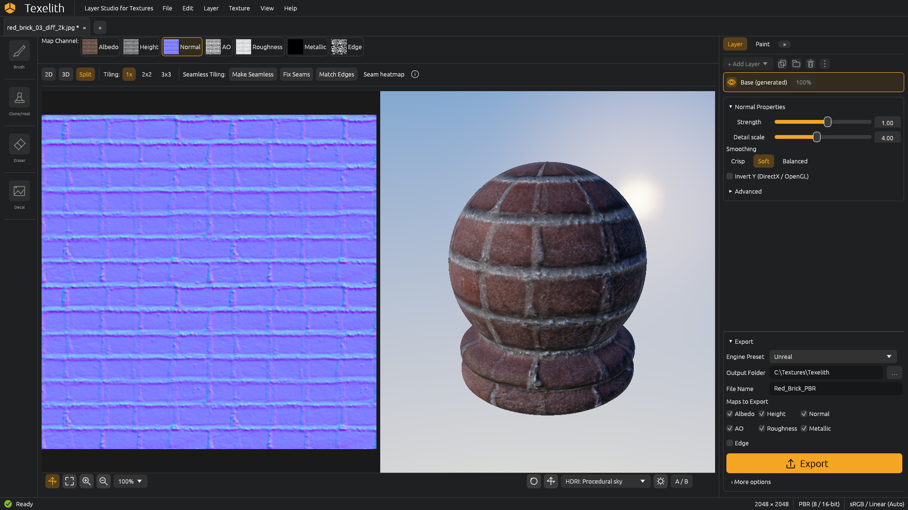
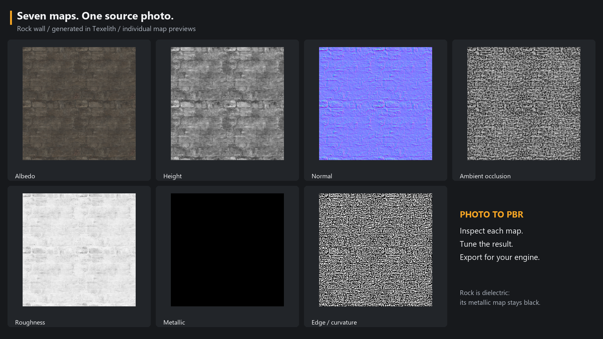
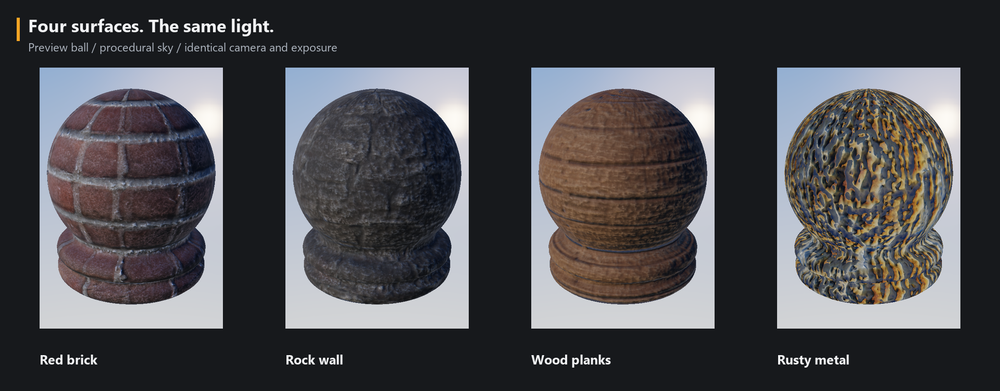
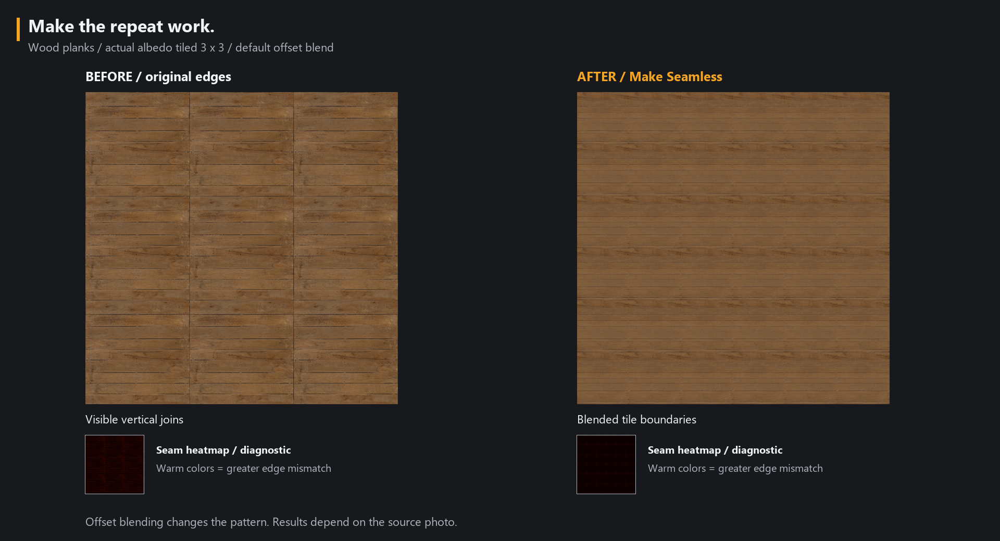
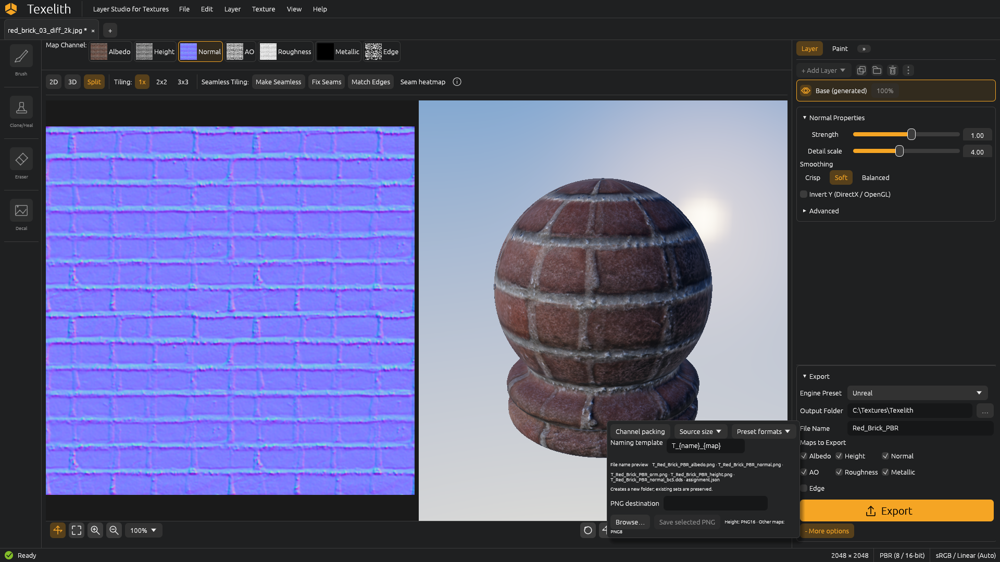

<p align="center">
  
</p>
<h1 align="center">Texelith</h1>
<p align="center"><strong>Turn a photo into an engine-ready, tileable PBR material set.</strong></p>
<p align="center">A lightweight desktop texture studio, built with Rust and GPU-native processing.</p>
<p align="center">
  <a href="https://github.com/Thyke/Texelith/actions/workflows/ci.yml"></a>
  <a href="LICENSE"></a>
  
</p>
<p align="center">
  <a href="https://github.com/Thyke/Texelith/releases"><strong>Download for Windows</strong></a> ·
  <a href="#quick-start">Quick start</a> ·
  <a href="ROADMAP.md">Roadmap</a>
</p>



## Why Texelith

- **One photo, seven maps.** Generate albedo, height, normal, ambient occlusion, roughness, metallic and edge maps.
- **See every adjustment.** Inspect maps in 2D and the material in 3D, with a split view and procedural sky or HDRI lighting.
- **Check the repeat.** Make textures seamless, preview tiling and inspect edge mismatch with a seam heatmap.
- **Go straight to your engine.** Export with Unreal, Unity and Godot presets; save projects or process images in batches.

## From source to surface



*Every map comes from the same rock wall photo. Nonmetal surfaces keep a black metallic map.*



*Four real photo inputs, the same camera and lighting. Rusty metal uses a color selection for its metallic response.*



*Compare the actual albedo: visible vertical joins blend away with Make Seamless. Small heatmap insets show edge mismatch; offset blending changes the pattern.*



*Choose the engine preset, output folder and maps. Unreal export includes DDS BC5 normals.*

## Quick start

1. Download the latest Windows build from [Releases](https://github.com/Thyke/Texelith/releases), unzip it and run `Texelith.exe`.
2. Open a texture photo, select a map and adjust its controls while inspecting the 2D or 3D preview.
3. Use **Make Seamless**, check a **3×3** repeat and enable **Seam heatmap** to inspect the edges.
4. Choose an export preset, folder and material name, select your maps and click **Export**.

Requires Windows 10 or later and a GPU with DirectX 12 or Vulkan support. Linux and macOS builds are experimental.

## Build from source

Install the Rust toolchain specified in [rust-toolchain.toml](rust-toolchain.toml) and the platform's native build tools. From the repository root:

```sh
cargo run -p texelith-ui-egui --release --locked
```

See [CONTRIBUTING.md](CONTRIBUTING.md) for development and verification commands.

## What's next

Phase 2 plans layer stacks, painting, clone/heal tools and decals. See the [roadmap](ROADMAP.md) for completed work and future ideas.

## AI-assisted development

Texelith is developed with AI assistance: Claude Code orchestrates the work and OpenAI Codex agents implement and test changes. Every change is reviewed, verified and merged by the maintainer.

## License and credits

[MIT](LICENSE). See [third-party notices](THIRD_PARTY_NOTICES.md) and the [asset licensing inventory](docs/licensing.md).

Sample textures: Poly Haven (CC0). [Screenshot sources and reproduction](docs/images/README.md).
